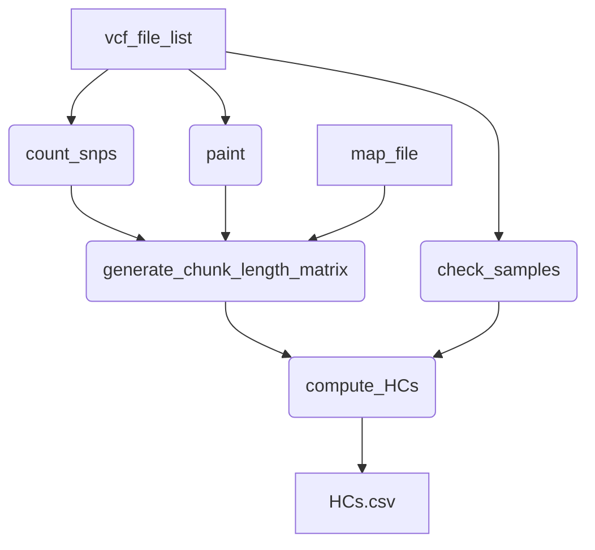

# Haplotype Components pipeline

A [Nextflow](https://www.nextflow.io/) (DSL2) pipeline for computing haplotype components (HCs) from phased genotype data, based on [the original pipeline](https://github.com/YaolingYang/SparsePainter/tree/main/painting-pipeline/Compute%20haplotype%20components%20(HCs)) from [Yang et al. (2025)](https://www.nature.com/articles/s41467-025-57601-3). It uses [PBWT](https://github.com/richarddurbin/pbwt) sparse chromosome painting to build a genome-wide chunk-length (chromosome-painting) matrix, then computes a sparse SVD of that matrix to derive HCs — low-dimensional summaries of haplotype sharing between individuals, analogous to genotype principal components.

## Pipeline overview

For each chromosome (in parallel):

0. **`subset_samples`** (only with `--keep_samples`) — subsets the input BCF/VCF to the listed samples, in the order of the list (`bcftools view -S`). Only these samples are painted, against each other. Sites that become monomorphic are kept.

1. **`count_snps`** — counts the number of SNPs in the input BCF/VCF (`bcftools`).

2. **`paint`** — performs PBWT sparse chromosome painting, producing a chunklengths file per chromosome (`pbwt -paintSparse`).

Across chromosomes:

3. **`check_samples`** — checks that all input files have the same samples in the same order, and writes the list of sample IDs (`bcftools`). The chunk-length matrix refers to samples by their position in this list.

4. **`generate_chunk_length_matrix`** — combines the per-chromosome chunklengths files, weighted by SNP counts and genetic map lengths, into a single genome-wide sparse chunk-length matrix (`combine`, a Rust CLI tool). If the matrix has more than `--restrict` entries, some are dropped: the smallest in the whole matrix, or the same fraction of every row (`--restrict_mode`). `combine` also writes each row's sum, calculated before any entries are dropped, and a binary copy of the matrix for `compute_HCs`.

5. **`compute_HCs`** — Optionally removes the entries of listed sample pairs, e.g. relatives (`--remove_pairs`), keeps only some samples' rows and columns for the SVD (`--fit_samples`), optionally projecting the others onto it (`--project`), and rescales each row of the matrix back to its sum before entries were removed (`--reweight`). Then it computes a truncated SVD of log10(matrix + 1), and writes the resulting haplotype components and per-sample diagnostics ([`hcsvd`](https://github.com/MRCIEU/hc-svd), a Rust program using a parallel restarted Lanczos SVD). It gives the same HCs as the original R step, which used `sparsesvd`, without its limit of 2^31−1 matrix entries.



Each process runs in its own Docker container (see [Dependencies](#dependencies) below); container images are configured per-process in [nextflow.config](nextflow.config).

## Requirements

- [Nextflow](https://www.nextflow.io/) (DSL2)
- Docker (enabled by default in [nextflow.config](nextflow.config))

## Parameters

| Parameter         | Required | Default      | Description                                                                                                                                                          |
|-------------------|----------|--------------|------------------------------------------------------------------------------------------------------------------------------------------------------------------- |
| `--vcf_file_list` | Yes      | *(none)*     | Path to a plain text file with one line per chromosome: `<chromosome index> <path to BCF/VCF file>`, whitespace-separated. Relative paths are resolved against the directory containing this file. |
| `--map_file`      | Yes      | *(none)*     | Path to a plain text file with one line per chromosome giving the genetic map length, in the same order as `vcf_file_list`.                                          |
| `--keep_samples`  | No       | *(none)*     | Path to a file of sample IDs, one per line. The input files are subset to these samples before painting, so only they are painted (e.g. to exclude relatives, as in Yang et al. 2025, or to paint one group on its own). Every ID must be in the input files. Output rows follow the order of this file. |
| `--nHCs`          | No       | `150`        | Number of haplotype components to compute.                                                                                                                          |
| `--outfile`       | No       | `HCs.csv`    | Name of the output file containing the computed haplotype components.                                                                                               |
| `--diagnostics`   | No       | `HC_diagnostics.tsv` | Name of the output file of per-sample diagnostics.                                                                                                          |
| `--publish_matrix` | No     | `false`      | Also publish the combined chunk-length matrix (`combined.chunklengths.txt.gz`), its row sums (`combined.chunklengths.sums`) and the sample list its indices refer to (`samples.txt`) to `<resultsdir>/matrix`, e.g. to re-run the HC step without repainting. |
| `--resultsdir`    | No       | `results`    | Directory that final results are published to.                                                                                                                      |
| `--paint_nchunks` | No       | `100`        | `pbwt -paintSparse`: number of chunks per region.                                                                                                                    |
| `--paint_ploidy`  | No       | `2`          | `pbwt -paintSparse`: ploidy.                                                                                                                                         |
| `--paint_cutoff`  | No       | `500`        | `pbwt -paintSparse`: minimum length (in SNPs) of a haplotype match for it to be counted.                                                                            |
| `--restrict`      | No       | `2147483647` | Maximum number of entries in the combined chunk-length matrix (`combine --restrict`), e.g. to limit memory use. The default, 2^31−1, was the most the original R HC step could hold; `hcsvd` has no limit. |
| `--restrict_mode` | No       | `global`     | Which entries `--restrict` drops (`combine --restrict-mode`). `global`: the smallest values in the whole matrix, so individuals whose values are mostly small can lose most of their row. `row-fraction`: the same fraction of every row's entries (each row keeps its largest values). |
| `--reweight`      | No       | `false`      | Before computing HCs, rescale each row of the matrix so it adds up to its total before `--restrict` and `--remove_pairs` removed entries (from `combine`'s `.sums` file). Has no effect if no entries were removed. |
| `--remove_pairs`  | No       | *(none)*     | Path to a file of sample-ID pairs (e.g. relatives, such as parent–offspring and sibling pairs) whose entries are removed from the matrix, in both directions, before computing HCs. The first two whitespace-separated columns are used; other columns are ignored. Pairs with an ID not in the data (or a header line) are skipped. Use with `--reweight`: on its own, removing a relative's entry leaves the rest of the row small, which shrinks that sample's HCs towards 0. |
| `--fit_samples`   | No       | *(none)*     | Path to a file of sample IDs, one per line. Only these samples' rows and columns of the matrix are used for the SVD (their entries to other samples are removed), and only they get HCs, in the order of the input files. E.g. HCs within one group, from a painting of everyone (unlike `--keep_samples`, which paints only the listed samples). IDs not in the data are skipped. Use with `--reweight`. |
| `--project`       | No       | `false`      | With `--fit_samples`: also give every other sample HCs, by projecting its row onto the SVD of the fitted samples (HCs = row × V·D^(−1/2), where the SVD of the fitted samples' matrix is U·D·Vᵀ and their HCs are U·√D). A projected sample's row has only its entries to fitted samples, after `--remove_pairs` and `--reweight`. E.g. fit on unrelated samples and project their relatives, so everyone has HCs on the same basis. When projecting relatives, use with `--remove_pairs` and `--reweight` (see [Handling relatives](#handling-relatives)). |

## Usage

```bash
nextflow run main.nf \
    --vcf_file_list /path/to/chr1-22_vcf_list.txt \
    --map_file /path/to/chr1-22.maplengths.txt
```

### Handling relatives

To fit the HCs on unrelated individuals and give their relatives HCs by projection, use **all four** options:

```bash
nextflow run main.nf ... \
    --fit_samples unrelated.txt \
    --project \
    --remove_pairs related_pairs.txt \
    --reweight
```

**Why all four:**
- `--fit_samples` + `--project` alone is not enough when a relative's close relatives are among the fitted samples, which is the usual case: e.g. a standard unrelated set keeps one person from each related pair.
- A painting row describes who a person copies from, so a close relative dominates it. In 1000G a median 92% of a child's row goes to its parents.
- Projected without removing those entries, relatives' HCs shrink to about a quarter of the size of unrelated people's, so they under-describe ancestry.
- `--remove_pairs` deletes the entries between listed relatives; `--reweight` restores each row's total. With them, relatives' HCs come out at about 0.8× the size.

**Two cautions:**
- **Projected HCs are noisier than fitted ones.** In 1000G trios, a child's projected HCs are on the right scale but about as far from its parents' average as a random member of its population is. That's fine for population-structure adjustment.
- **Within-family analyses** (e.g. sibling GWAS) should give family members consistent covariates (e.g. the family average) or leave HCs out. Differences between relatives' HCs are largely method noise.

**The pairs file:**
- `--remove_pairs` reads the first two whitespace-separated columns.
- From a KING `.kin0` file (columns `FID1 ID1 FID2 ID2 ... Kinship`), take the IDs and filter on kinship. For example, first- and second-degree relatives (kinship ≥ 0.0884):

  ```bash
  awk 'NR == 1 {for (i = 1; i <= NF; i++) if ($i == "Kinship") k = i; next} $k >= 0.0884 {print $2, $4}' king.kin0 > related_pairs.txt
  ```

- A first- or second-degree cut-off is the safer default. With third-degree pairs, many more are removed. In founder or isolated populations, where background relatedness is high, that can strip out the recent shared ancestry HCs are meant to capture.

## Output

The pipeline publishes two files to `<resultsdir>`:

- **`<outfile>`** (default `HCs.csv`): the haplotype components. A CSV file with one row per individual (per individual in `--fit_samples`, if given, plus the projected individuals with `--project`), in the same order as the samples in the input BCF/VCFs (`pbwt` combines both of an individual's haplotypes into one row), and columns `sample, HC1, HC2, ..., HC<nHCs>`.
- **`<diagnostics>`** (default `HC_diagnostics.tsv`): per-sample diagnostics, tab-separated, one row per individual in the input files (including any not in `--fit_samples`), in the same order:

| Column            | Description |
|-------------------|-------------|
| `sample`          | Sample ID. |
| `n_entries`       | Number of entries in the individual's row of the chunk-length matrix (after `--restrict`). |
| `total_precap`    | Total of the row before `--restrict` dropped entries (from `combine`'s `.sums` file), in cM. About 2 × the total map length, lower if the individual had no matches on some chromosomes. |
| `total_kept`      | Total of the row after `--restrict`, before `--remove_pairs` and any reweighting, in cM. |
| `frac_kept`       | `total_kept / total_precap`: the share of the row left after `--restrict`. |
| `largest_share`   | Share of the row taken by its largest entry. In 1000G the median is about 0.02 for samples without close relatives in the data and about 0.75 for parent–child trio members, so high values usually mean a close relative is in the dataset. |
| `frac_removed`    | Share of the row (after `--restrict`) removed by `--remove_pairs`. |
| `frac_outside`    | Share of the row (after `--restrict`) to samples not in `--fit_samples` (0 without it; NA for samples with no HCs). |
| `n_entries_used`  | Number of entries in the row used for the HCs, after `--remove_pairs`. |
| `reweight_factor` | Factor the row was scaled by with `--reweight` (1 otherwise). Large values mean the row's HCs rest on a small part of its original total. |
| `status`          | `fitted`: the individual's row was used in the SVD; `projected`: projected onto the SVD (`--project`); `not fitted`: not in `--fit_samples` and not projected (no HCs). |

With `--publish_matrix`, `<resultsdir>/matrix` also contains the combined chunk-length matrix (`combined.chunklengths.txt.gz`: `index1 index2 value`, space-separated, 1-based indices into `samples.txt`), its row sums before `--restrict` (`combined.chunklengths.sums`: `index1 sum`), and `samples.txt`.

## Testing

A small test dataset is included in [testdata](testdata): 334 samples from the 1000 Genomes high-coverage phased data, every 10th HapMap 3 SNP on chromosomes 1–22 (~15 MB). There are 300 unrelated samples (60 from each of AFR, AMR, EAS, EUR and SAS), plus 10 parent–child trios (2 per superpopulation) and 2 sibling pairs without their parents. `testdata/related_pairs.txt` lists the 22 related pairs (parent–offspring and sibling) among the samples, from the 1000G pedigree. Run it with the `test` profile, then check the output:

```bash
nextflow run main.nf -profile test
testdata/check_hcs.sh results/HCs.csv 10
```

`check_hcs.sh` checks the shape of the output (one row per sample, 10 HCs, all values finite) and that the leading HCs separate the superpopulations.

Because the test data is thinned and has few samples, the `test` profile lowers `paint_cutoff` to 20 SNPs; with the default (500) almost no matches pass the cutoff. The test profile also sets `nHCs` to 10.

[testdata/make_testdata.sh](testdata/make_testdata.sh) rebuilds the test data from the full 1000G BCFs (already subset to HapMap 3 SNPs), choosing the samples with [testdata/select_samples.sh](testdata/select_samples.sh).

### Automated tests

[tests/test_pipeline.sh](tests/test_pipeline.sh) runs the whole pipeline on the test profile with each option, and checks failures (e.g. input files whose samples are in a different order). It needs Nextflow and the built images:

```bash
tests/test_pipeline.sh
```

The GitHub Actions workflow [.github/workflows/test.yml](.github/workflows/test.yml) builds the images (with layer caching), installs Nextflow and runs it, on pushes and pull requests to `main` (and on request, from the Actions tab).

The HC step itself is tested in [hc-svd](https://github.com/MRCIEU/hc-svd): against the original R step, and for what its options do (e.g. to relatives' HCs), on a painting of 904 1000 Genomes samples.

## Dependencies

Each pipeline process runs in a dedicated Docker image, built from the [dependencies](dependencies) directory:

| Directory | Tool(s) | Licence |
|---|---|---|
| [dependencies/bcftools](dependencies/bcftools) | [`bcftools`](https://samtools.github.io/bcftools/) 1.24 | MIT/Expat |
| [dependencies/pbwt](dependencies/pbwt) | [`pbwt`](https://github.com/richarddurbin/pbwt) v2.1 | Apache-2.0 |
| [dependencies/combine](dependencies/combine) | [`combine`](https://github.com/MRCIEU/combine-pbwt-sparsepaint) v0.8.0: merges the per-chromosome chunklengths files into one genome-wide sparse matrix (Rust) | GPL-3.0 |
| [dependencies/hc_svd](dependencies/hc_svd) | [`hcsvd`](https://github.com/MRCIEU/hc-svd) v0.3.0: haplotype components by truncated SVD (restarted Lanczos; Rust) | MIT |

Each directory contains a `Dockerfile` and a `build.sh` script to build and tag the corresponding image. Each image includes its programs' licence files, under `/usr/share/licenses`. Tags are given for example purposes. They must correspond to the names in `nextflow.config`

## Licence

MIT (see [LICENSE](LICENSE)). The programs the pipeline runs have their own licences (see [Dependencies](#dependencies) and [NOTICE](NOTICE)).
