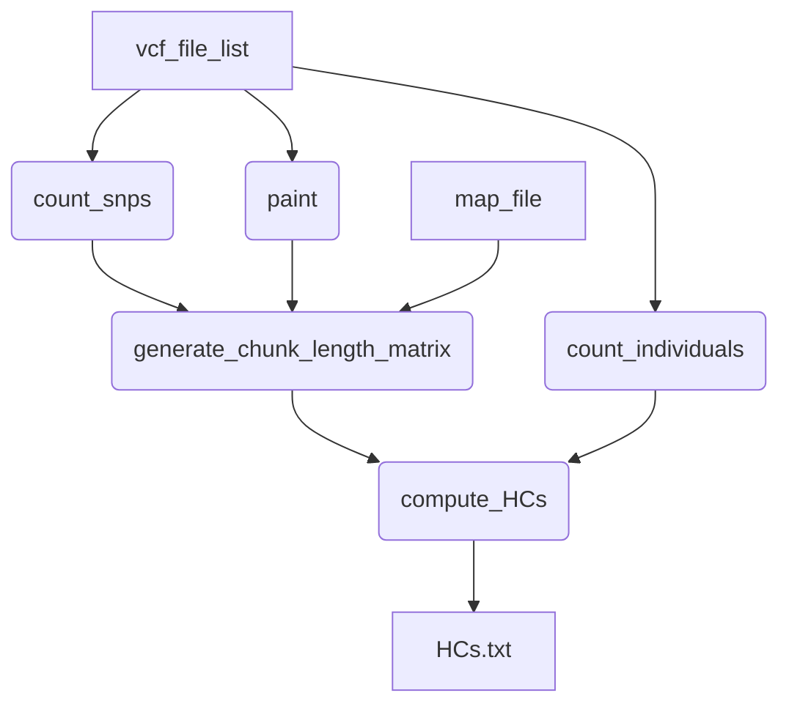

# Haplotype Components pipeline

A [Nextflow](https://www.nextflow.io/) (DSL2) pipeline for computing haplotype components (HCs) from phased genotype data. It uses [PBWT](https://github.com/richarddurbin/pbwt) sparse chromosome painting to build a genome-wide chunk-length (chromosome-painting) matrix, then computes a sparse SVD of that matrix to derive HCs — low-dimensional summaries of haplotype sharing between individuals, analogous to genotype principal components.

## Pipeline overview

For each chromosome (in parallel):
1. **`count_snps`** — counts the number of SNPs in the input BCF/VCF (`bcftools`).
2. **`paint`** — performs PBWT sparse chromosome painting, producing a chunklengths file per chromosome (`pbwt -paintSparse`).

Across chromosomes:
3. **`count_individuals`** — determines the (single, shared) number of individuals across all input files (`bcftools`).
4. **`generate_chunk_length_matrix`** — combines the per-chromosome chunklengths files, weighted by SNP counts and genetic map lengths, into a single genome-wide sparse chunk-length matrix (`combine`, a Rust CLI tool).
5. **`compute_HCs`** — Computes a truncated SVD from the sparse matrix, and writes the resulting haplotype components (`calculate_haplotype_components`, an R script using `sparsesvd`).



Each process runs in its own Docker container (see [Dependencies](#dependencies) below); container images are configured per-process in [nextflow.config](nextflow.config).

## Requirements

- [Nextflow](https://www.nextflow.io/) (DSL2)
- Docker (enabled by default in [nextflow.config](nextflow.config))

## Parameters

| Parameter         | Required | Default      | Description                                                                                                                                                          |
|-------------------|----------|--------------|------------------------------------------------------------------------------------------------------------------------------------------------------------------- |
| `--vcf_file_list` | Yes      | *(none)*     | Path to a plain text file with one line per chromosome: `<chromosome index> <path to BCF/VCF file>`, whitespace-separated.                                          |
| `--map_file`      | Yes      | *(none)*     | Path to a plain text file with one line per chromosome giving the genetic map length, in the same order as `vcf_file_list`.                                          |
| `--nHCs`          | No       | `150`        | Number of haplotype components to compute.                                                                                                                          |
| `--outfile`       | No       | `HCs.txt`    | Name of the output file containing the computed haplotype components.                                                                                               |
| `--resultsdir`    | No       | `results`    | Directory that final results are published to.                                                                                                                      |

## Usage

```bash
nextflow run main.nf \
    --vcf_file_list /path/to/chr1-22_vcf_list.txt \
    --map_file /path/to/chr1-22.maplengths.txt
```

## Output

The pipeline publishes the computed haplotype components to `<resultsdir>/<outfile>` (by default `results/HCs.txt`): a CSV file with one row per haplotype and columns `HC1, HC2, ..., HC<nHCs>`.

## Dependencies

Each pipeline process runs in a dedicated Docker image, built from the [dependencies](dependencies) directory:

| Directory                                           | Tool(s)                                                             |
|-----------------------------------------------------|---------------------------------------------------------------------|
| [dependencies/bcftools](dependencies/bcftools)      | [`bcftools`](https://samtools.github.io/bcftools/) 1.24             |
| [dependencies/pbwt](dependencies/pbwt)              | [`pbwt`](https://github.com/richarddurbin/pbwt) v2.1                |
| [dependencies/combine](dependencies/combine)        | `combine` — a Rust CLI tool that merges per-chromosome chunklengths files into a single sparse genome-wide matrix |
| [dependencies/calculate_HCs](dependencies/calculate_HCs) | `calculate_haplotype_components` — an R script computing sparse SVD-based haplotype components |

Each directory contains a `Dockerfile` and a `build.sh` script to build and tag the corresponding image. Tags are given for example purposes. They must correspond to the names in `nextflow.config`

