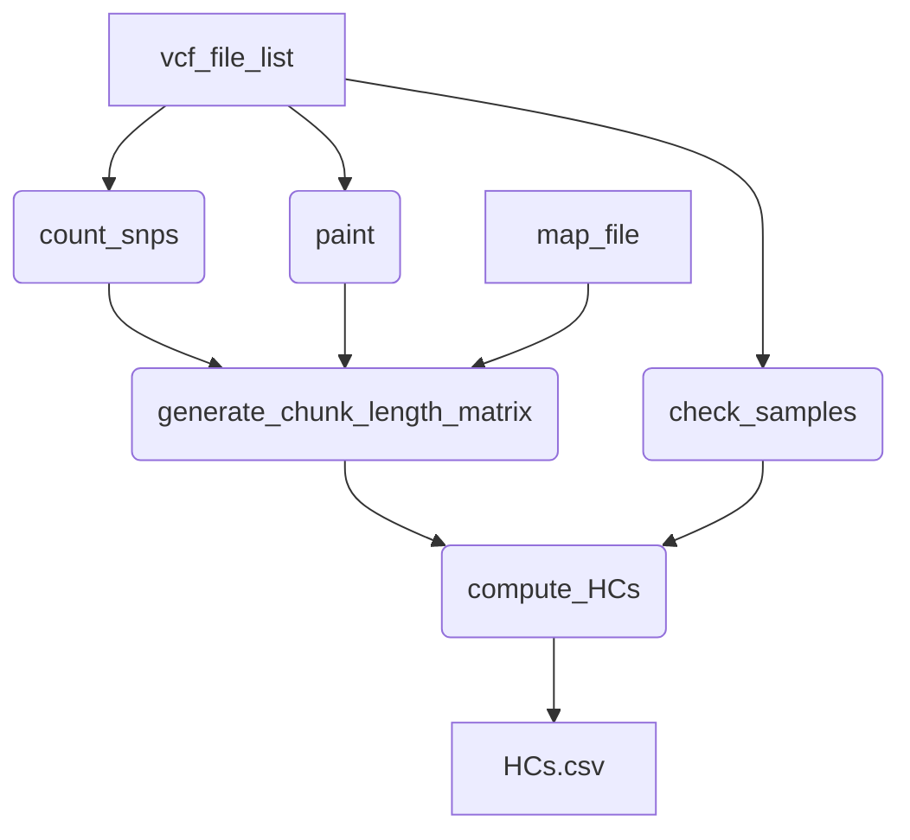

# Haplotype Components pipeline

A [Nextflow](https://www.nextflow.io/) (DSL2) pipeline for computing haplotype components (HCs) from phased genotype data, based on [the original pipeline](https://github.com/YaolingYang/SparsePainter/tree/main/painting-pipeline/Compute%20haplotype%20components%20(HCs)) from [Yang et al. (2025)](https://www.nature.com/articles/s41467-025-57601-3). It uses [PBWT](https://github.com/richarddurbin/pbwt) sparse chromosome painting to build a genome-wide chunk-length (chromosome-painting) matrix, then computes a sparse SVD of that matrix to derive HCs — low-dimensional summaries of haplotype sharing between individuals, analogous to genotype principal components.

## Pipeline overview

For each chromosome (in parallel):

0. **`subset_samples`** (only with `--keep_samples`) — subsets the input BCF/VCF to the listed samples, in the order of the list (`bcftools view -S`). Only these samples are painted, against each other. Sites that become monomorphic are kept.

1. **`count_snps`** — counts the number of SNPs in the input BCF/VCF (`bcftools`).

2. **`paint`** — performs PBWT sparse chromosome painting, producing a chunklengths file per chromosome (`pbwt -paintSparse`).

Across chromosomes:

3. **`check_samples`** — checks that all input files have the same samples in the same order, and writes the list of sample IDs (`bcftools`). The chunk-length matrix refers to samples by their position in this list.

4. **`generate_chunk_length_matrix`** — combines the per-chromosome chunklengths files, weighted by SNP counts and genetic map lengths, into a single genome-wide sparse chunk-length matrix (`combine`, a Rust CLI tool). If the matrix has more than `--restrict` entries, the smallest are dropped. `combine` also writes each row's sum, calculated before any entries are dropped.

5. **`compute_HCs`** — Optionally (`--reweight`) rescales each row of the matrix back to its sum before entries were dropped. Then it computes a truncated SVD from the sparse matrix, and writes the resulting haplotype components and per-sample diagnostics (`calculate_haplotype_components`, an R script using `sparsesvd`).



Each process runs in its own Docker container (see [Dependencies](#dependencies) below); container images are configured per-process in [nextflow.config](nextflow.config).

## Requirements

- [Nextflow](https://www.nextflow.io/) (DSL2)
- Docker (enabled by default in [nextflow.config](nextflow.config))

## Parameters

| Parameter         | Required | Default      | Description                                                                                                                                                          |
|-------------------|----------|--------------|------------------------------------------------------------------------------------------------------------------------------------------------------------------- |
| `--vcf_file_list` | Yes      | *(none)*     | Path to a plain text file with one line per chromosome: `<chromosome index> <path to BCF/VCF file>`, whitespace-separated. Relative paths are resolved against the directory containing this file. |
| `--map_file`      | Yes      | *(none)*     | Path to a plain text file with one line per chromosome giving the genetic map length, in the same order as `vcf_file_list`.                                          |
| `--keep_samples`  | No       | *(none)*     | Path to a file of sample IDs, one per line. The input files are subset to these samples before painting, so only they are painted (e.g. to exclude relatives, as in Yang et al. 2025, or to paint one group on its own). Every ID must be in the input files. Output rows follow the order of this file. |
| `--nHCs`          | No       | `150`        | Number of haplotype components to compute.                                                                                                                          |
| `--outfile`       | No       | `HCs.csv`    | Name of the output file containing the computed haplotype components.                                                                                               |
| `--diagnostics`   | No       | `HC_diagnostics.tsv` | Name of the output file of per-sample diagnostics.                                                                                                          |
| `--publish_matrix` | No     | `false`      | Also publish the combined chunk-length matrix (`combined.chunklengths.txt.gz`), its row sums (`combined.chunklengths.sums`) and the sample list its indices refer to (`samples.txt`) to `<resultsdir>/matrix`, e.g. to re-run the HC step without repainting. |
| `--resultsdir`    | No       | `results`    | Directory that final results are published to.                                                                                                                      |
| `--paint_nchunks` | No       | `100`        | `pbwt -paintSparse`: number of chunks per region.                                                                                                                    |
| `--paint_ploidy`  | No       | `2`          | `pbwt -paintSparse`: ploidy.                                                                                                                                         |
| `--paint_cutoff`  | No       | `500`        | `pbwt -paintSparse`: minimum length (in SNPs) of a haplotype match for it to be counted.                                                                            |
| `--restrict`      | No       | `2147483647` | Maximum number of entries in the combined chunk-length matrix (`combine --restrict`); the smallest values are dropped first. The default, 2^31−1, is the most R's Matrix package can hold. |
| `--reweight`      | No       | `false`      | Before computing HCs, rescale each row of the matrix so it adds up to its total before `--restrict` dropped entries (from `combine`'s `.sums` file). Has no effect if no entries were dropped. |

## Usage

```bash
nextflow run main.nf \
    --vcf_file_list /path/to/chr1-22_vcf_list.txt \
    --map_file /path/to/chr1-22.maplengths.txt
```

## Output

The pipeline publishes two files to `<resultsdir>`:

- **`<outfile>`** (default `HCs.csv`): the haplotype components. A CSV file with one row per individual, in the same order as the samples in the input BCF/VCFs (`pbwt` combines both of an individual's haplotypes into one row), and columns `sample, HC1, HC2, ..., HC<nHCs>`.
- **`<diagnostics>`** (default `HC_diagnostics.tsv`): per-sample diagnostics, tab-separated, one row per individual in the same order:

| Column            | Description |
|-------------------|-------------|
| `sample`          | Sample ID. |
| `n_entries`       | Number of entries in the individual's row of the chunk-length matrix (after `--restrict`). |
| `total_precap`    | Total of the row before `--restrict` dropped entries (from `combine`'s `.sums` file), in cM. About 2 × the total map length, lower if the individual had no matches on some chromosomes. |
| `total_kept`      | Total of the row after `--restrict`, before any reweighting, in cM. |
| `frac_kept`       | `total_kept / total_precap`: the share of the row left after `--restrict`. |
| `largest_share`   | Share of the row taken by its largest entry. In 1000G the median is about 0.02 for samples without close relatives in the data and about 0.75 for parent–child trio members, so high values usually mean a close relative is in the dataset. |
| `reweight_factor` | Factor the row was scaled by with `--reweight` (1 otherwise). |
| `status`          | `fitted`: the individual's row was used in the SVD. |

With `--publish_matrix`, `<resultsdir>/matrix` also contains the combined chunk-length matrix (`combined.chunklengths.txt.gz`: `index1 index2 value`, space-separated, 1-based indices into `samples.txt`), its row sums before `--restrict` (`combined.chunklengths.sums`: `index1 sum`), and `samples.txt`.

## Testing

A small test dataset is included in [testdata](testdata): 334 samples from the 1000 Genomes high-coverage phased data, every 10th HapMap 3 SNP on chromosomes 1–22 (~15 MB). There are 300 unrelated samples (60 from each of AFR, AMR, EAS, EUR and SAS), plus 10 parent–child trios (2 per superpopulation) and 2 sibling pairs without their parents. `testdata/related_pairs.txt` lists the 22 related pairs (parent–offspring and sibling) among the samples, from the 1000G pedigree. Run it with the `test` profile, then check the output:

```bash
nextflow run main.nf -profile test
Rscript testdata/check_hcs.R results/HCs.csv 10 hcs.png
```

`check_hcs.R` checks the shape of the output (one row per sample, 10 HCs, all values finite) and that the leading HCs separate the superpopulations, and optionally writes a scatter plot of HC1–HC4.

Because the test data is thinned and has few samples, the `test` profile lowers `paint_cutoff` to 20 SNPs; with the default (500) almost no matches pass the cutoff. The test profile also sets `nHCs` to 10.

[testdata/make_testdata.sh](testdata/make_testdata.sh) rebuilds the test data from the full 1000G BCFs (already subset to HapMap 3 SNPs), choosing the samples with [testdata/select_samples.sh](testdata/select_samples.sh).

### HC-step test data

[testdata/hc](testdata/hc) has test data for the HC step on its own (`calculate_haplotype_components`), without painting: a combined chunk-length matrix (`combined.chunklengths.txt.gz`), its row sums (`combined.chunklengths.sums`), `samples.txt`, `samples_superpop.txt` and `related_pairs.txt` (~1.8 MB). Unlike the thinned BCFs, it is painted at full HapMap 3 density with the production settings (`-paintSparse 100 2 500`), so it has realistic sparsity and structure, both between and within superpopulations. It has 904 samples: 750 unrelated (150 per superpopulation), 50 parent–child trios and 2 sibling pairs (102 related pairs). [testdata/make_hc_testdata.sh](testdata/make_hc_testdata.sh) rebuilds it by running the pipeline on the full 1000G BCFs with `--keep_samples` and `--publish_matrix`.

## Dependencies

Each pipeline process runs in a dedicated Docker image, built from the [dependencies](dependencies) directory:

| Directory                                           | Tool(s)                                                             |
|-----------------------------------------------------|---------------------------------------------------------------------|
| [dependencies/bcftools](dependencies/bcftools)      | [`bcftools`](https://samtools.github.io/bcftools/) 1.24             |
| [dependencies/pbwt](dependencies/pbwt)              | [`pbwt`](https://github.com/richarddurbin/pbwt) v2.1                |
| [dependencies/combine](dependencies/combine)        | [`combine`](https://github.com/MRCIEU/combine-pbwt-sparsepaint) v0.6.0 — a Rust CLI tool that merges per-chromosome chunklengths files into a single sparse genome-wide matrix |
| [dependencies/calculate_HCs](dependencies/calculate_HCs) | `calculate_haplotype_components` — an R script computing sparse SVD-based haplotype components |

Each directory contains a `Dockerfile` and a `build.sh` script to build and tag the corresponding image. Tags are given for example purposes. They must correspond to the names in `nextflow.config`

